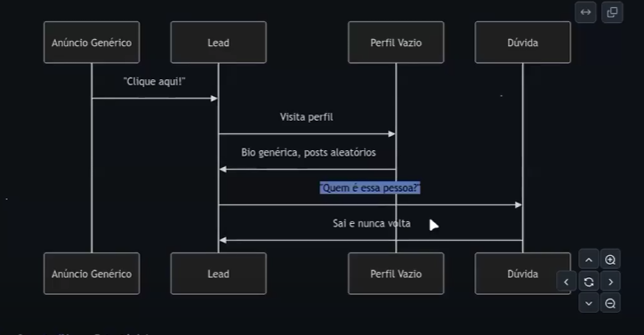
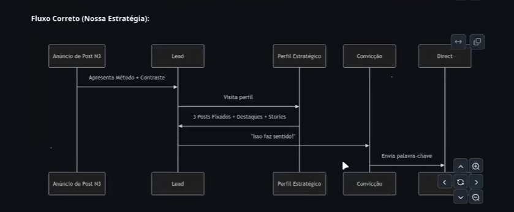
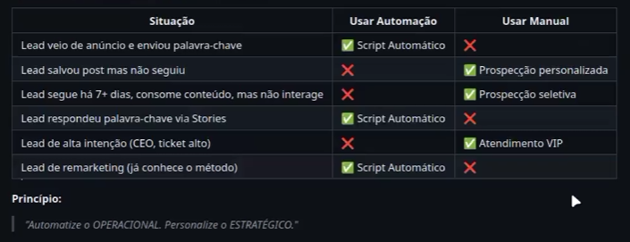

## Pilar 1. Conteúdo estratégico

Posts N3 como base
Stories de remarketing 
Destaques = Autoridade

Conteúdo PRIMEIRO e anuncios DEPOIS

Fluxo Errado:

Fluxo Certo:

3 posts fixados:
1. Explicativo (O que é o metodo)
2. Transformação (como fica a vida depois)
3. Contraste (Por que é melhor que soluções comuns) <- Este vai para o Anuncio.

## Pilar 2. Tráfego Inteligente

Não faremos:
- Anúncios de conversão direta
- Compre agora
- Segmentação ampla sem critério
- Investir alto esperando milagre
- Lead magnet fraco

Faremos:
- Anúncios que EDUCAM primeiro
- Entenda por que isso é melhor
- Segmentação por nível de consciência
- R$30/dia com ROI mensurável
- Post N3 como isca (Conteúdo Valioso)

Níveis de Consciência do Mercado (Eugene Schwartz)

Nossa Estratégia foca em Níveis 3, 4 e 5

A comunicação para atrair essas pessoas de 3 nível de consciência, vamos usar no topo do funil e buscando expulsar as pessoas da camada 1 e 2.

1.Meta ADS distribuindo conteúdo inteligente, não oferta
2.Segmentação por consciência
3.R$ 30/dia = ROI positivo

## Pilar 2 Atendimento Automatizado + Prospecção Seletiva

Lead Qualificado Entra no sistema -> De onde Veio? ->
	
	Canal 1:
Anuncio -> Responde palavra chave no direct -> Script Automatico Many Chat -> Qualificação Manual -> Lead Qualificado ? 
Sim: Proposta Principal ou reunião
Não: Conteúdo Gratuito ou downsell

	Canal 2:
Orgânico Stores -> Responde palavra-chave via Stories -> Script Automático Many Chat ->  Qualificação Manual -> Lead Qualificado ? 
Sim: Proposta Principal ou reunião
Não: Conteúdo Gratuito ou downsell

	 Canal 3: 
 Prospecção Outbound -> Conversa manual personalizada -> Qualificação Manual -> Lead Qualificado ? 
Sim: Proposta Principal ou reunião
Não: Conteudo Gratuito ou downsell

Automação vs Manual: Quando usar cada um?

### Jornada do Lead Qualificado:

**Descoberta Anuncio**
1. Ve Post N3 no Feed
2. Identifica com o problema sofisticado
3. Le sobre o metodo
4. Ve constraste com solucoes comuns

O que o Lead Ve no anuncio: 
_____________
[Imagem do Post N3 - Card 1]

"Se voce ainda faz [Solução comum], está perdendo tempo e dinheiro.

Para [Público Alvo] que ja tentaram [Solucoes comuns] e ainda enfrentam [Efeito Colateral].

Existe uma forma mais simples.

👉 Leia o post completo

[Ver Mais] [Curtir] [Comentar]

-------------------

Gatilhos Ativados:
- Polarização - Contradiz crença comum
- Identificação - Reconhece o problema sofisticado
- Curiosidade - "Existe uma forma mais simples"
- Autoridade Implícita - Está anunciando = Investe nisso

**Interesse (Perfil)**
1. Clica no Perfil
2. Ve post 1/3 (Explicativo)
3. Ve post 2/3 (Transformação)
4. Ve Post 3/3 (Constraste)
5. Confere Destaques e Prova social

Engajamento (Interação)
1. Decide interagit
2. Envia palavra-chave no Direct

Qualificação (Perguntas)
1. Responde

Conversão (Decisão)
1. Lead qualificado recebe proposta
2. Toma decisão de compra

Atendimento Automático no Direct
Prospecção só em quem ja interagiu
Combinação inbound + outbound

## Estruturas das Campanhas:

- Turbinar nos carrosséis
- Segmentar por idade, brasil, cidades principais. Interesses (Concorrentes diretos do seu nicho, Ferramentas que seu publico usa, gurus/influencers que seu publico segue, solucoes comuns do mercado)

Copy dos anuncios para captação:
[Imagem: Card 1 do Post N3 - Contraste]

Se você ainda [SOLUÇÃO COMUM], está perdendo
tempo e dinheiro.

Para [PÚBLICO ALVO] que já tentaram:
• [Solução Comum 1]
• [Solução Comum 2]
• [Solução Comum 3]

E ainda enfrentam [EFEITO COLATERAL].

Existe uma forma mais simples: [MÉTODO].

👉 Leia o post completo

📊 Métricas da Campanha 1

|Métrica|Meta|Como Calcular|
|---|---|---|
|CPM (Custo por mil impressões)|R$ 15-30|R$ gasto ÷ Impressões × 1000|
|CPC (Custo por clique)|R$ 0,30-0,80|R$ gasto ÷ Cliques no post|
|Clique no Perfil|200-400/mês|Via Instagram Insights|
|Custo por Clique no Perfil|R$ 0,50-2,00|R$ gasto ÷ Cliques no perfil|
|Taxa de Salvamento|5-10%|Salvamentos ÷ Alcance × 100|
|Visitante → Seguidor|15-25%|Novos seguidores ÷ Cliques perfil × 100|

Campanha 2 - Remarketing para Engajados

Story 1/3

Você viu meu post sobre
[MÉTODO].

Mais de [X] pessoas já
usam isso para
[RESULTADO].

⬆️ Deslize

Story 2/3

Sem precisar:
❌ [Solução Comum 1]
❌ [Solução Comum 2]
❌ [Solução Comum 3]

Apenas [MÉTODO RESUMIDO]

⬆️ Deslize

Story 3/3

Quer saber como aplicar
no seu negócio?

Responda no Direct:
[PALAVRA-CHAVE]

👇 Enviar Mensagem

Campanhas de fundo de Funil: (Remarketing para infoproduto de downsell, para agendamento de reunião caso o lead não agendou ainda)

🎥 Estrutura do Vídeo/Reels (15-30s)

Formato vencedor:

[00s-03s] GANCHO
"Como [Nome Cliente] saiu de R$X para R$Y
em [tempo] usando [Método]"

[03s-10s] PROBLEMA
"Ele estava preso em [Soluções Comuns]
e enfrentando [Efeito Colateral]"

[10s-20s] SOLUÇÃO
"Implementamos [Método]:
• Passo 1
• Passo 2
• Passo 3"

[20s-28s] RESULTADO
"Resultado: R$Y em [tempo]
Sem [Efeito Colateral]"

[28s-30s] CTA
"Quer o mesmo? Responda VIP no Direct"

📊 Métricas da Campanha 3

|Métrica|Meta|Observação|
|---|---|---|
|Custo por Resultado|R$ 10-25|Palavra-chave enviada|
|Taxa de Conversão|40-60%|Público ultra-quente|
|CAC (Custo Aquisição Cliente)|R$ 150-400|Depende do ticket|

## Criativos que Convertem

📊 Os 3 Tipos de Criativos (Quando usar cada um)

Estágio do Lead → Qual criativo?

1. NÃO CONHECE VOCÊ
   TIPO 1:
   Post N3 Carrossel
   Contraste
   → Campanha 1
     Topo de Funil

2. JÁ VISITOU PERFIL
   TIPO 2:
   Stories Estáticos
   Remarketing
   → Campanha 2
     Meio de Funil

3. SEGUIDOR 7+ DIAS
   TIPO 3:
   Vídeo/Reels
   Case de Sucesso
   → Campanha 3
     Fundo de Funil

🎨 TIPO 1: Posts N3 (Carrossel)

Qual dos 3 Posts Fixados usar no anúncio?

| Post Fixado | Quando usar | Taxa de Clique Esperada |
|---|---|---|
| 1/3 - Explicativo | Lead nível 2-3 consciência (sabe problema, não sabe sua solução) | 2-4% |
| 2/3 - Transformação | Lead nível 3 (quer visualizar resultado) | 3-5% |
| 3/3 - Contraste ⭐ | Lead nível 3-4 (já tentou Soluções Comuns) | 5-8% |

Por que o 3/3 (Contraste) é o vencedor?

✅ Checklist para testar variações do Post N3

☐ Testar Card 1 com diferentes afirmações provocativas
☐ Testar CTA diferente no último card ("Comente POST" vs "Mande DM")
☐ Testar ordem dos cards (começar com case vs começar com problema)
☐ Testar design (minimalista vs colorido)
☐ Testar quantidade de cards (6 vs 8 vs 10)

Regra de ouro: Mude UMA variável por vez para saber o que funciona.

📱 TIPO 2: Stories Estáticos (6-14 cards)

Estrutura vencedora (Sequência de 8 Stories):

Story 1: Resultado Impressionante
"R$50k em 2 semanas vendendo [serviço] usando [Método]"

Story 2: "Como?"
"Sem [Solução Comum 1], [Solução Comum 2] ou [Solução Comum 3]"

Story 3: Introdução do Método
"Usando apenas [Método resumido em 1 linha]"

Story 4: Prova Social
"[X] pessoas já usam... Case: [resultado de cliente]"

Story 5: O Segredo
"O segredo? [Princípio único do método]"

Story 6: Benefício Principal
"Para que você possa [benefício emocional]"

Story 7: Teaser
"Segunda-feira vou mostrar exatamente como fazer isso"

Story 8: CTA
"Se quiser acesso antes, responda: ACESSO"

Funciona por é formato nativo do instagram (Menos cara de anuncio), storytelling (prende atenção), CTA no final (depois de gerar desejo)

🎥 TIPO 3: Vídeo/Reels Curto (15-30s)

Anatomia de um Reels que converte:

VÍDEO → LEAD → EMOÇÃO

[00s-03s: GANCHO]
Mostra resultado chocante
→ Curiosidade ativada

[03s-10s: PROBLEMA]
"Ele estava preso em X"
→ Identificação

[10s-20s: SOLUÇÃO]
"Fizemos Y em 3 passos"
→ Esperança

[20s-28s: RESULTADO]
"Alcançou Z sem W"
→ Desejo

[28s-30s: CTA]
"Responda VIP no Direct"
→ Urgência de agir

Elementos visuais que aumentam retenção:

• ✅ Legenda chamativa nos primeiros 3s
• ✅ Transições rápidas (cortes a cada 3-5s)
• ✅ B-roll mostrando "prova" (print de resultado, depoimento, etc)
• ✅ Música trending (aumenta alcance orgânico)
• ✅ Você aparecendo (humaniza, gera conexão)

📝 FÓRMULA UNIVERSAL DE COPY PARA ANÚNCIOS

[LINHA 1: Afirmação Provocativa que gera Polarização]
"Se você ainda [Solução Comum], está [consequência negativa]."

[LINHA 2: Validação do Problema Sofisticado]
"Para [Público Alvo] que já tentaram [Soluções Comuns]
e ainda enfrentam [Efeito Colateral]."

[LINHA 3: Introdução do Método - 1 linha]
"Existe uma forma mais simples: [Método]."

[LINHA 4: CTA claro]
"👉 [Ação desejada]"

Exemplo aplicado (Nutricionista):

Se você ainda faz dietas restritivas para emagrecer,
está sabotando seu próprio metabolismo.

Para mulheres 35+ que já tentaram low-carb, jejum
intermitente e shakes detox, mas voltam a engordar
toda vez que param.

Existe uma forma mais simples: Emagrecimento Metabólico.

👉 Leia o post completo